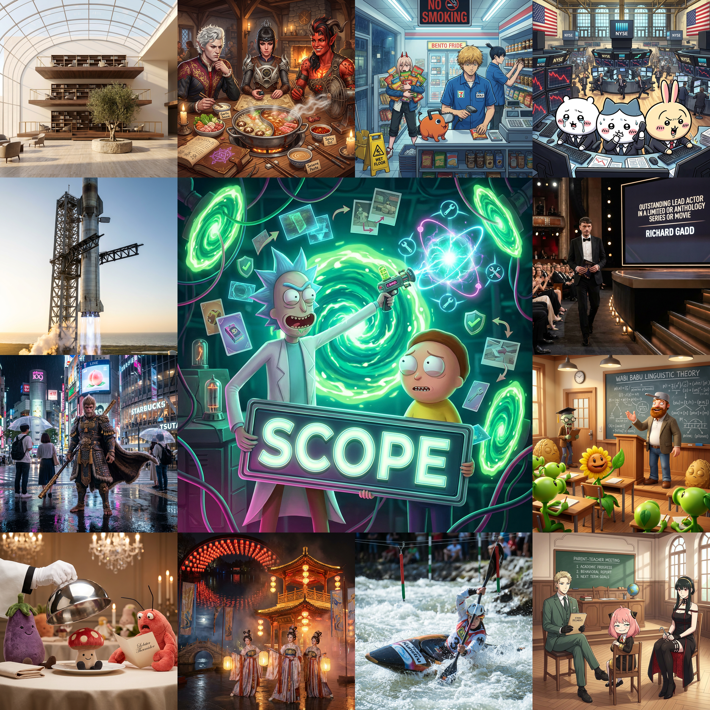
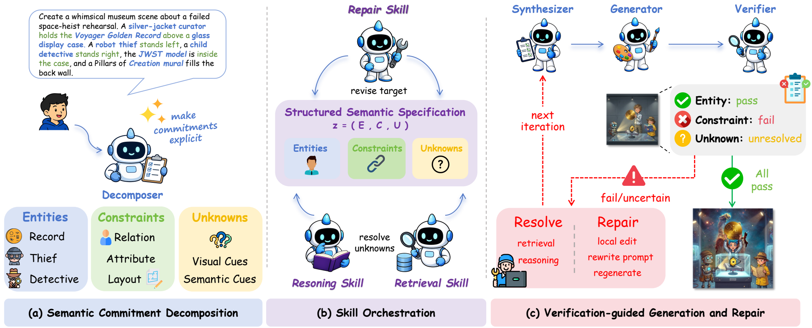
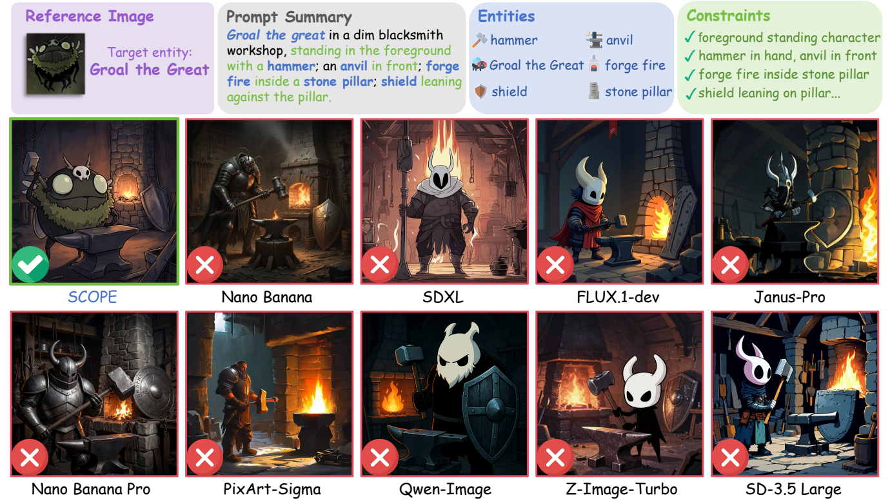
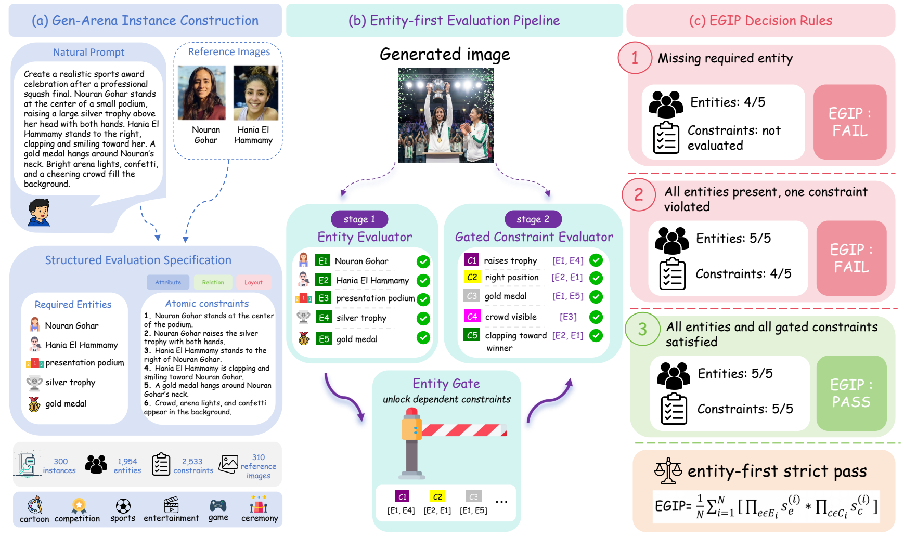

<div align="center">
  <h1>SCOPE</h1>
  <p><strong>Structured Decomposition and Conditional Skill Orchestration for Complex Image Generation</strong></p>
  <p>
    <a href="https://arxiv.org/abs/2605.08043"></a>
    <a href="https://nopnor.github.io/SCOPE/"></a>
    <a href="https://huggingface.co/datasets/rentianfei122/Gen-Arena"></a>
    <a href="LICENSE"></a>
  </p>
  
</div>

SCOPE is a specification-guided framework for complex image generation. It turns a prompt into persistent semantic commitments, then conditionally invokes retrieval, reasoning, generation, verification, and repair skills so entities and constraints remain traceable throughout the generation lifecycle.

## Highlights

| Reported result | Score | What it measures |
| --- | ---: | --- |
| Gen-Arena | **0.60 EGIP** | Strict entity-first intent realization |
| WISE-V | **0.907** | Complex visual-intent performance |
| MindBench | **0.61** | Multi-requirement image-generation capability |

- **Persistent specification.** Track entities, constraints, and unknowns as a shared structured semantic specification.
- **Conditional skill orchestration.** Resolve ambiguity or evidence gaps only where they arise, instead of blindly regenerating an image.
- **Verification-guided repair.** Gate constraints on entity satisfaction, localize failures, then repair the unresolved commitments.
- **Gen-Arena benchmark.** Evaluate commitment-level intent realization with entity- and constraint-level specifications and the Entity-Gated Intent Pass Rate (EGIP).

## How SCOPE Works



A decomposer makes the prompt commitments explicit. Retrieval and reasoning skills resolve unknowns; the synthesizer and generator produce the candidate image; an entity-first verifier decides whether constraints can be evaluated; targeted repair handles failures or uncertainty before the next iteration.

## Results

### Complex Prompt Realization



SCOPE preserves the target entity and its grounded constraints in a difficult multi-object prompt, where the compared generators miss or alter one or more commitments.

### Gen-Arena and Entity-First Evaluation



Gen-Arena pairs natural prompts with explicit entities, atomic constraints, and reference images. EGIP only passes an instance after all required entities and their gated constraints are satisfied.

## Installation

**Requirements:** Python 3.10+, Codex CLI for the full agent-driven workflow, and optional API keys for image generation, verification, and search backends.

~~~bash
pip install -e .

# Development and tests
pip install -e ".[dev]"
pytest -q
~~~

## Configuration

Copy the example environment file, then add the providers and keys needed by your run.

~~~bash
cp configs/scope.example.env .env
set -a
source configs/scope.example.env
set +a
~~~

The main environment variables are:

- **SCOPE_IMAGE_PROVIDER** and **SCOPE_IMAGE_API_KEY** for image generation.
- **SCOPE_JUDGE_PROVIDER** and **SCOPE_JUDGE_API_KEY** for verification.
- **SCOPE_SEARCH_PROVIDER** and **SCOPE_SERPER_API_KEY** for optional evidence retrieval.

See [configs/scope.example.yaml](configs/scope.example.yaml) for the YAML equivalent.

## Quick Start

The full workflow is agent-driven. Its primary skill is [scope-agentic-generation](.codex/skills/scope-agentic-generation/SKILL.md). Ask Codex to use this skill with a prompt and an output directory; the workflow prepares and persists decomposition, retrieval, reasoning, synthesis, verification, repair, and evaluation artifacts.

~~~text
decompose -> retrieve or reason when needed -> synthesize -> generate -> verify -> repair when needed -> finalize -> evaluate
~~~

A minimal stage validation call is:

~~~bash
python -m scope.cli.stage \
  --stage decompose \
  --prompt "A clean math poster showing the correct result of 17 + 28 in large readable numerals." \
  --decomposition-json outputs/demo/decomposition.input.json \
  --state outputs/demo/state.json \
  --output-dir outputs/demo

python -m scope.cli.evaluate --run-dir outputs/demo
~~~

A completed run includes **state.json**, **final_prompt.txt**, generated images, **metrics.json**, and stage artifacts such as **decomposition.json**, **synthesis.json**, and **verification.json**.

## Gen-Arena Evaluation

Gen-Arena is released separately on [Hugging Face](https://huggingface.co/datasets/rentianfei122/Gen-Arena). Materialize the evaluation packets, dispatch runs, then summarize and score entity and constraint commitments.

~~~bash
scope-benchmark materialize-gen-arena-eval \
  --dataset-root /path/to/Gen-Arena \
  --output-root benchmark/materialized/gen_arena

scope-benchmark run-codex \
  --index benchmark/materialized/gen_arena/cases.index.json \
  --run-root outputs/gen-arena-full \
  --concurrency 10

scope-benchmark summarize --run-root outputs/gen-arena-full

scope-gen-arena-eval \
  --materialized-root benchmark/materialized/gen_arena \
  --run-root outputs/gen-arena-full
~~~

For prompt-only cases, use:

~~~bash
scope-benchmark materialize-gen-arena \
  --prompt-jsonl /path/to/Gen-Arena/category/prompt.jsonl \
  --output-root benchmark/materialized/gen_arena_prompt_only
~~~

## Command Reference

| Command | Purpose |
| --- | --- |
| **scope-stage** | Validate and persist a workflow stage. |
| **scope-eval** | Summarize a completed run directory. |
| **scope-search** | Collect web or image evidence for retrieval branches. |
| **scope-benchmark** | Materialize, dispatch, and summarize benchmark cases. |
| **scope-gen-arena-eval** | Compute Gen-Arena entity and constraint metrics. |

The commands are also available as Python modules:

~~~bash
python -m scope.cli.stage --help
python -m scope.cli.evaluate --help
python -m scope.cli.benchmark --help
python -m scope.cli.gen_arena_eval --help
~~~

## Repository Layout

~~~text
.codex/skills/  Codex workflow skills for SCOPE generation
configs/        Runtime configuration examples
docs/           Project page and architecture notes
src/scope/      Python stage tools, contracts, and runtime backends
tests/          Unit and smoke tests
~~~

## Citation

If you find SCOPE or Gen-Arena useful, please cite:

~~~bibtex
@misc{ren2026scope,
  title={SCOPE: Structured Decomposition and Conditional Skill Orchestration for Complex Image Generation},
  author={Tianfei Ren and Zhipeng Yan and Yiming Zhao and Zhen Fang and Yu Zeng and Guohui Zhang and Hang Xu and Xiaoxiao Ma and Shiting Huang and Ke Xu and Wenxuan Huang and Lionel Z. Wang and Lin Chen and Zehui Chen and Jie Huang and Feng Zhao},
  year={2026},
  eprint={2605.08043},
  archivePrefix={arXiv},
  url={https://arxiv.org/abs/2605.08043}
}
~~~

## License

This project is released under the [MIT License](LICENSE).
# SCOPE

[](https://arxiv.org/abs/2605.08043)
[](https://nopnor.github.io/SCOPE/)
[](https://huggingface.co/datasets/rentianfei122/Gen-Arena)
[](LICENSE)

Official code release for **SCOPE: Structured Decomposition and Conditional Skill Orchestration for Complex Image Generation**.

SCOPE is a specification-guided framework for complex image generation. It represents a prompt as persistent semantic commitments, including entities, constraints, and unknowns, then uses retrieval, reasoning, generation, verification, and repair stages to keep those commitments traceable throughout the generation lifecycle.

- Paper: [arXiv:2605.08043](https://arxiv.org/abs/2605.08043)
- Project page: [https://nopnor.github.io/SCOPE/](https://nopnor.github.io/SCOPE/)
- Gen-Arena dataset: [Hugging Face](https://huggingface.co/datasets/rentianfei122/Gen-Arena)
- Architecture notes: [docs/architecture.md](docs/architecture.md)

## Overview

Complex image prompts often contain many requirements that must remain identifiable across evidence gathering, prompt synthesis, image generation, verification, and repair. SCOPE treats these requirements as semantic commitments and stores them in a structured specification. Each stage reads and updates this shared specification, allowing downstream actions to target unresolved or violated commitments instead of regenerating blindly.

This repository contains:

- Codex workflow skills for SCOPE-style agentic generation under `.codex/skills`
- Python stage tools, contracts, runtime adapters, and CLIs under `src/scope`
- Example runtime configuration files under `configs`
- Gen-Arena materialization, dispatch, summarization, and evaluation utilities
- A GitHub Pages project page under `docs`

The release does not include private credentials, generated experiment outputs, or bundled benchmark data. Download Gen-Arena separately from Hugging Face when running benchmark evaluation.

## Installation

Requirements:

- Python 3.10+
- Codex CLI for the full agent-driven workflow
- Optional API keys for image generation, verification, and search backends

Install the package in editable mode:

```bash
pip install -e .
```

For development and tests:

```bash
pip install -e ".[dev]"
pytest -q
```

## Configuration

SCOPE reads runtime settings from environment variables. Start from the example file:

```bash
cp configs/scope.example.env .env
```

For a shell session, you can load the example environment as:

```bash
set -a
source configs/scope.example.env
set +a
```

Main settings:

- `SCOPE_IMAGE_PROVIDER`: image generation provider
- `SCOPE_IMAGE_API_KEY`: image generation API key
- `SCOPE_JUDGE_PROVIDER`: verifier provider
- `SCOPE_JUDGE_API_KEY`: optional verifier API key
- `SCOPE_SEARCH_PROVIDER`: search provider, for example `serper`
- `SCOPE_SERPER_API_KEY`: optional Serper API key for external-reference retrieval

The corresponding YAML example is [configs/scope.example.yaml](configs/scope.example.yaml).

## Quick Start

The full SCOPE workflow is agent-driven. The main workflow skill is:

```text
.codex/skills/scope-agentic-generation/SKILL.md
```

In a Codex session, ask Codex to use the SCOPE skill with your prompt and an output directory. Codex prepares the decomposition, retrieval, reasoning, synthesis, verification, and repair payloads; the Python CLIs validate and persist each stage artifact.

The workflow is:

```text
decompose -> retrieve/reason when needed -> synthesize -> generate -> verify -> repair when needed -> finalize -> evaluate
```

Required or conditional stage input artifacts:

- `decomposition.input.json`
- `retrieval.input.json` when retrieval is needed
- `reasoning.input.json` when reasoning is needed
- `synthesis.input.json`
- `verification.input.json`
- `repair.input.json` when repair is needed

Minimal stage validation example:

```bash
mkdir -p outputs/demo

cat > outputs/demo/decomposition.input.json <<'JSON'
{
  "entities": [
    {"id": "o1", "name": "math poster", "priority": "primary"}
  ],
  "constraints": [
    {
      "id": "c1",
      "text": "The poster shows the correct result 45 in large readable numerals.",
      "type": "text",
      "priority": "critical",
      "spec": {"require_readable_text": true}
    }
  ],
  "unknowns": []
}
JSON

python -m scope.cli.stage \
  --stage decompose \
  --prompt "A clean math poster showing the correct result of 17 + 28 in large readable numerals." \
  --decomposition-json outputs/demo/decomposition.input.json \
  --state outputs/demo/state.json \
  --output-dir outputs/demo
```

After a completed run, summarize workflow metrics:

```bash
python -m scope.cli.evaluate --run-dir outputs/demo
```

Typical run outputs include:

- `state.json`
- `final_prompt.txt`
- generated image files
- `metrics.json`
- stage artifacts such as `decomposition.json`, `synthesis.json`, and `verification.json`

## Gen-Arena Evaluation

Gen-Arena is released separately as a public dataset:

```text
https://huggingface.co/datasets/rentianfei122/Gen-Arena
```

Materialize Gen-Arena `eval.jsonl` files into runtime and evaluation packets:

```bash
scope-benchmark materialize-gen-arena-eval \
  --dataset-root /path/to/Gen-Arena \
  --output-root benchmark/materialized/gen_arena
```

This creates:

```text
benchmark/materialized/gen_arena/<case_id>/benchmark_input.json
benchmark/materialized/gen_arena/<case_id>/benchmark_eval.json
benchmark/materialized/gen_arena/cases.index.json
```

Dispatch materialized cases to independent Codex runs:

```bash
scope-benchmark run-codex \
  --index benchmark/materialized/gen_arena/cases.index.json \
  --run-root outputs/gen-arena-full \
  --concurrency 10
```

Summarize workflow metrics:

```bash
scope-benchmark summarize --run-root outputs/gen-arena-full
```

Evaluate Gen-Arena entity and constraint commitments:

```bash
scope-gen-arena-eval \
  --materialized-root benchmark/materialized/gen_arena \
  --run-root outputs/gen-arena-full
```

For prompt-only generation cases, use a JSONL file with `id` and `prompt`:

```bash
scope-benchmark materialize-gen-arena \
  --prompt-jsonl /path/to/Gen-Arena/category/prompt.jsonl \
  --output-root benchmark/materialized/gen_arena_prompt_only
```

## Command Reference

- `scope-stage`: validate and persist one workflow stage
- `scope-eval`: summarize one completed run directory
- `scope-search`: collect web or image evidence for retrieval branches
- `scope-benchmark`: materialize, dispatch, and summarize benchmark cases
- `scope-gen-arena-eval`: compute Gen-Arena entity and constraint metrics

The commands can also be run as Python modules:

```bash
python -m scope.cli.stage --help
python -m scope.cli.evaluate --help
python -m scope.cli.benchmark --help
python -m scope.cli.gen_arena_eval --help
```

## Repository Layout

```text
.codex/skills/      Codex workflow skills for SCOPE generation
configs/            Runtime configuration examples
docs/               Project page and architecture notes
src/scope/          Python stage tools, contracts, and runtime backends
tests/              Unit and smoke tests
```

## Citation

If you find SCOPE or Gen-Arena useful, please cite:

```bibtex
@misc{ren2026scope,
  title         = {SCOPE: Structured Decomposition and Conditional Skill Orchestration for Complex Image Generation},
  author        = {Tianfei Ren and Zhipeng Yan and Yiming Zhao and Zhen Fang and Yu Zeng and Guohui Zhang and Hang Xu and Xiaoxiao Ma and Shiting Huang and Ke Xu and Wenxuan Huang and Lionel Z. Wang and Lin Chen and Zehui Chen and Jie Huang and Feng Zhao},
  year          = {2026},
  eprint        = {2605.08043},
  archivePrefix = {arXiv},
  url           = {https://arxiv.org/abs/2605.08043}
}
```

## License

This project is released under the MIT License. See [LICENSE](LICENSE).
